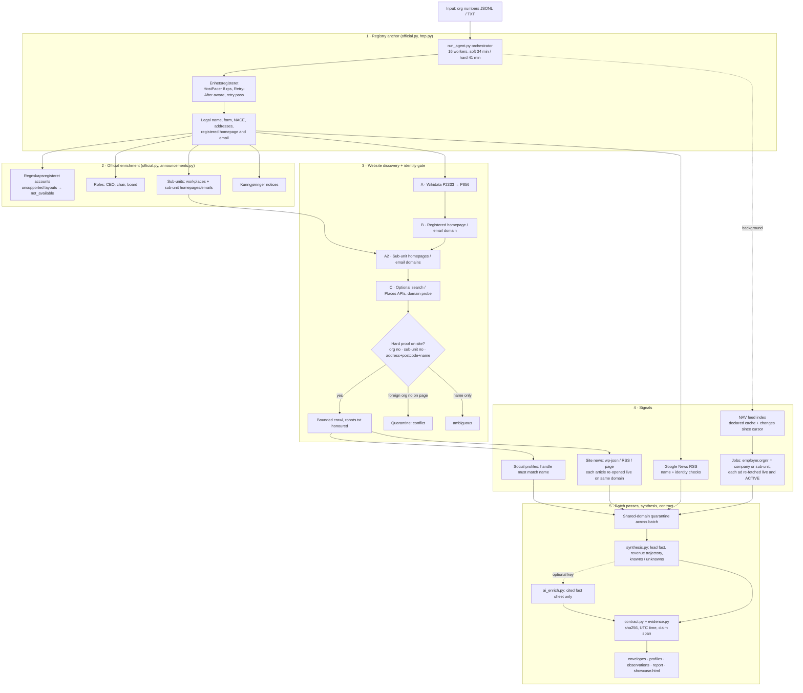

# ARCHITECTURE.md — Signalpost system architecture

Signalpost turns 9-digit Norwegian organisation numbers into evidence-backed company dossiers that follow [`OUTPUT_CONTRACT.md`](OUTPUT_CONTRACT.md).

The organisation number is the root of trust. Official registry data anchors each company. A claim from the open web is published only after it passes an identity gate. When the evidence is unclear, the field is published as `ambiguous` rather than guessed.

Subsystem deep dives are in [`docs/architecture/`](docs/architecture/README.md):
1. [System overview & orchestration](docs/architecture/SYSTEM_OVERVIEW.md)
2. [Identity resolution & anti-contamination gates](docs/architecture/IDENTITY_AND_GATING.md)
3. [Data pipeline, contracts & evidence lineage](docs/architecture/DATA_PIPELINE_AND_STORAGE.md)
4. [External integrations & connectors](docs/architecture/INTEGRATIONS_AND_CONNECTORS.md)
5. [Cost, performance & resource governance](docs/architecture/COST_AND_RESOURCE_GOVERNANCE.md)

---

## 1. Pipeline

Five stages run per company; the NAV index and Wikidata lookups run once per batch in the background.

---

## 2. Components

Each subsection names the modules that implement it.

### 2.1 Registry anchor and official enrichment (`official.py`, `announcements.py`, `http.py`)
- **Sources:** Brønnøysundregistrene open APIs: Enhetsregisteret, Regnskapsregisteret, roles and `underenheter`. Kunngjøringer notices come from `w2.brreg.no`.
- **Request pacing:** a `HostPacer` holds Brreg to 8 requests per second.
  - Retries honour `Retry-After`.
  - Companies whose registry calls failed get a second retry pass at the end of the batch.
- **Accounts:**
  - Newest filing first, and company accounts (`SELSKAP`) are preferred over group accounts (`KONSERN`).
  - A missing line item is never turned into 0.
  - Filing layouts the open API cannot serve (banks, pension funds, non-profits) come back as HTTP 500 with "oppstillingsplan som ikke er støttet". These return `not_available` with the server's reason, are not retried and are not counted as failures.
- **Sub-units:**
  - Every workplace is listed in a stable org-number order, so a re-run reports no false changes.
  - Homepages and email domains registered on sub-units (`subunit_contacts`) become website candidates only (step A2). They are never published directly.
- **Notices:** grouped as bankruptcy, liquidation, capital change, board change and similar. Routine address-change notices stay out of the summary.

### 2.2 Website discovery (`run_agent.py`, `discovery.py`, `web_discovery.py`)
The waterfall stops at the first candidate that passes the identity gate:

| Step | Source | Key needed |
|---|---|---|
| A | Wikidata SPARQL (`P2333` org no → `P856` website) | no |
| B | Registered homepage / company email domain (free-mail domains excluded) | no |
| A2 | Sub-unit homepages (weight 2) and email domains (weight 1), up to 2 hosts; the registry email domain, generic and blocked hosts are excluded | no |
| C | Serper / Brave / Google search, Google Places, `.no` / `.com` domain probe | search and Places need keys; the probe needs none |

Optional discovery stops after the soft deadline.

### 2.3 Identity and conflict gates (`identity.py`, `site_proof.py`, `publication_gates.py`)
- **Proof for websites the registry does not list:** the site must show one of these:
  - the company's org number;
  - a registered sub-unit number;
  - the registered street address and postcode next to the legal name;
  - a domain that spells a multi-word legal name, together with the exact legal name and form, or a registered place that isn't part of the name. This route is refused if the page shows any other company's org number (`site_proof.name_domain_location_proof`).
- **Sites tied to the company by an official source** need only the legal-name check: the registry homepage, the registry email domain, or Wikidata's org-number → website link.
- **A name match alone** gives `ambiguous` and nothing is published.
- **Conflict quarantine** (`identity.verify_candidate_identity`): a page whose 9-digit numbers include none of the company's own numbers (org number, sub-units, group) is quarantined with `conflict: true`.
  - **Where it applies:** every candidate tried through `_try_candidate_site`, which covers Wikidata, step A2 sub-unit sites, search, Places and the domain probe.
  - **Where it doesn't:** the registry email-domain step. The company itself declared that domain to Brreg.
  - **NAV jobs:** they don't depend on websites. They are matched on `employer.orgnr` only.
- **Shared-domain quarantine:** after the batch, a domain claimed by several companies is kept only for the company whose own org number is on the site.

### 2.4 Crawl and extraction (`website.py`, `site_feeds.py`, `job_postings_ld.py`)
- **Crawl limits:** a bounded set of pages: home, `/kontakt`, `/om-oss`, `/karriere`, `/nyheter` and similar. `robots.txt` is honoured and timeouts apply.
- **Social profiles:** LinkedIn, Facebook, Instagram, YouTube and X. The handle must contain the distinctive company name, and site-builder or agency handles are dropped.
- **Site news:**
  - **Sources:** WordPress REST, RSS/Atom, JSON-LD and dated article pages.
  - **Liveness:** each article is re-opened live and kept only if it opens on the same registered domain. Up to 6 are checked per company, and the final URL plus `page_sha256` are recorded.
  - **Never counted as news:**
    - page regions with several headings or links;
    - service, product and shop pages;
    - CMS duplicates such as "copy" or "kopi";
    - "no vacancies" notices.
- **Contact details:** published only when they belong to the company.
  - Emails must be on the verified site's domain or the registered email domain.
  - Phone numbers must come from `tel:` links, structured data or a phone label, never a bare 8-digit run.
  - Addresses must be at a registered postcode and city (main unit or sub-unit), reduced to "street no, postcode city" (`contract.clean_registered_addresses`).
- **Parked pages:** parked and hosting-placeholder pages fail the identity gate.
- **Site jobs:** schema.org `JobPosting` and links to ATS platforms (Webcruiter, Teamtailor, Recman, Jobbnorge and others). Headings, buttons and login links ("Ledig stilling", "Stillingsannonsen", "Medarbeiderinnlogging") are never job titles (`website.GENERIC_JOB_HEADING`).

### 2.5 NAV vacancy connector (`nav_jobs.py`, `cache.py`, `data/cache/`)
- **Source:** the official feed `pam-stilling-feed.nav.no/api/v1/feed`, read with NAV's public token.
- **Index:** a background thread builds it.
  - When a declared cache exists that is no older than `NAV_FEED_DAYS` (45), only the feed pages after the cache's cursor are walked.
  - Otherwise the last 45 days are walked.
  - The cache is `data/cache/nav-jobs.jsonl.gz`, built 2026-11-20: 9,499 active ads at 5,197 employers.
- **Cache integrity:** `manifest.json` records the sha256 of each file. If the hash doesn't match, the cache is ignored.
- **Matching:** strictly by `employer.orgnr`, which must be the company or one of its registered sub-units.
- **Live re-check:** every cached ad is re-fetched live and published only if it is still `ACTIVE` for that employer. The cache says where to look; it is never a source of claims.
- **Rebuild:** `scripts/cache/build_nav_cache.py walk|entries|pack` can resume and can top up a finished walk.

### 2.6 Synthesis (`synthesis.py`, `ui/template.html`)
- **Lead:** opens with one fact a buyer would act on, with its source: a bankruptcy or liquidation notice, open jobs, the revenue trajectory or the balance sheet.
- **Revenue trajectory:**
  - It reports the year-on-year change and the CAGR over the filed years.
  - A one-year rise against a falling long-run trend is a "rebound"; a fall against a rising trend is a "dip".
  - The lead adds the long-run comparison, for example "but below X in YEAR".
- **Knowns and unknowns:** listed explicitly, e.g. "No website could be confirmed as this company's own."
- **Summary bullets:** the UI splits them with `splitSentences`, which never breaks inside quotes or after a middle initial.

### 2.7 Optional AI enrichment (`ai_enrich.py`)
- Runs only with `ANTHROPIC_API_KEY`.
- The model gets a numbered fact sheet of facts that were already verified.
- Any sentence without a valid `[fact-N]` citation is removed, as is any sentence whose numbers aren't in the facts it cites.
- Spend counts against the cost breaker.

### 2.8 Evidence lineage and contract (`evidence.py`, `contract.py`, `batch.py`)
- **Evidence record:** every published claim points to one. It holds the canonical URL, source class (`official_registry`, `company_owned`, `licensed_feed`, …), UTC retrieval time, verbatim `claim_span` and the SHA-256 of the fetched payload.
- **Envelopes:** each company ends in a final state: `available`, `not_available`, `blocked`, `not_applicable`, `ambiguous` or `failed`. A company is never dropped silently.
- **Batch audit:** `audit_envelopes` checks that claims and evidence references match and that no financials were fabricated.

### 2.9 Refresh (`--prior-profiles`)
- Compares the new profiles with the previous run and reports added, removed and changed facts.
- Stable ordering means a re-run with no changes reports 0 changes (smoke: 0).

### 2.10 Showcase (`ui/build_ui.py`, `showcase.py`)
- A single HTML page with no dependencies (`--showcase`, also published as `docs/index.html`).
- Features:
  - search and status filters;
  - multi-year financial tables;
  - an evidence drawer for each claim;
  - layouts for desktop and mobile.

---

## 3. Technology

| Area | Choice | Why |
|---|---|---|
| Runtime | Python 3.12, `uv` with `uv.lock` | Pinned, reproducible setup with one evaluator command |
| HTTP | Standard library `urllib` via `http.py` | No heavy dependencies; per-host pacing and Retry-After handling |
| Parsing | BeautifulSoup4, lxml, trafilatura | Tolerant HTML parsing and text extraction |
| Concurrency | `ThreadPoolExecutor`, 16 workers by default | Work is I/O-bound; registry calls are paced separately |
| Tests | `unittest`, 690 tests, fully offline (`make test`) | Network is blocked with a black-hole proxy |

---

## 4. Limits and guarantees

1. **Cost:**
   - A global `CostGovernor` breaker stops spending at $9.50, and `BudgetSlices` caps each provider.
   - With no keys, the run costs $0.00.
2. **Time:**
   - The soft deadline (34 min) stops optional discovery and crawling.
   - The hard deadline (41 min) stops AI work.
   - Every company is still written. Measured: 1,000 new companies in 26 minutes.
3. **Resumable runs:** `--checkpoint-every N` writes completed records as it goes, and `--resume` skips companies already done.
4. **Precision over recall:**
   - Unclear identity gives `ambiguous`.
   - Blocked sources give `blocked`. For example, Google News may answer automated clients with a 503; the agent records `blocked` and doesn't try to get around it.
