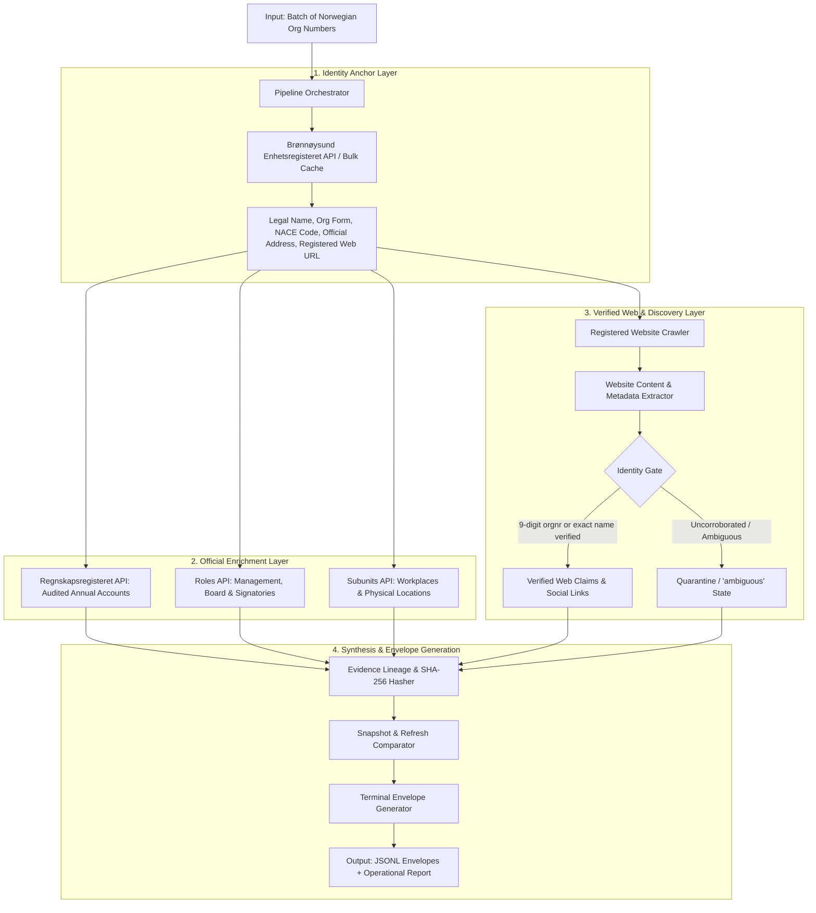

# ARCHITECTURE.md — Signalpost System Architecture

Architectural blueprint and component specifications for the Signalpost company intelligence system.

## 1. High-Level System Overview

Signalpost is structured around an **Anchor-Enrich-Verify-Synthesize** pipeline. The 9-digit Norwegian organisation number (*orgnr*) serves as the immutable root of trust. External claims from websites, search engines, or public activity are admitted into published profiles only if they pass cryptographic and deterministic identity gates.

---

## 2. Core Architectural Components

The system is decomposed into modular stages enforcing identity isolation, strict cryptographic evidence lineage, and idempotent state synchronization.

### 2.1 Identity Anchor (`src/norway_company_agent/identity.py`)
- **Authority:** Brønnøysundregistrene Enhetsregisteret (`data.brreg.no/enhetsregisteret/api/enheter/{orgnr}`).
- **Purpose:** Extracts canonical entity metadata (legal form `AS`, `ENK`, `DA`, `ASA`, NACE sector code, registration date, registered address, employee headcount, registered homepage URL).
- **Anti-Contamination Rule:** If the input orgnr does not resolve in official Norwegian registries, it immediately generates a terminal envelope with state `not_available` or `failed`.

### 2.2 Financials & Accounting (`src/norway_company_agent/official.py`)
- **Authority:** Regnskapsregisteret API (`data.brreg.no/regnskapsregisteret/regnskap/{orgnr}`).
- **Normalized Schema:** Extracts Revenue (*salgsinntekter*), Operating Profit (*driftsresultat*), Net Annual Profit (*årsresultat*), Assets (*sum eiendeler*), Debt (*sum gjeld*), and Accounting Period dates.
- **Rule of Non-Fabrication:** Missing line items are never zeroed. If no filing exists for the latest year, `availability: "not_available"` is emitted with explicit legal rationale (e.g. newly formed entity, exempt legal form).

### 2.3 Roles & Workplaces (`src/norway_company_agent/official.py`)
- **Roles:** Retrieves active management (*daglig leder*), board chair (*styreleder*), and board members.
- **Subunits:** Queries registered branch workplaces (*underenheter*) with physical municipality (*kommune*) and addresses.

### 2.4 Website Crawling, Multi-Provider Search Discovery & Number Profile Identity Gate (`src/norway_company_agent/website.py`, `discovery.py`, `identity.py`)
- **HTTP Engine:** Fast, polite HTTP client with rate-limiting, custom User-Agent, timeout bounds (5-10s), and robots/redirect compliance.
- **Interchangeable Search Discovery (Choose 1 of 3, or None):**
  - **Option 1 — Google Search via Serper (`SERPER_API_KEY`):** High-precision Google web search proxy (~$0.001/query).
  - **Option 2 — Brave Search API (`BRAVE_SEARCH_API_KEY`):** Privacy-first independent web index (~$0.005/query).
  - **Option 3 — Google Custom Search API (`GOOGLE_SEARCH_API_KEY` + `GOOGLE_SEARCH_ENGINE_ID`):** Official Google Programmable Search JSON API (~$0.005/query).
  - **Provider Auto-Detection & Explicit Override:** The unified resolver `resolve_search_provider()` automatically picks whichever key is present in `.env`, or honors `WEB_SEARCH_PROVIDER=auto|serper|brave|google`. If no keys are provided, the system executes 100% free statutory discovery.
- **Name + Town Search Discovery:** Queries search engines with `{name} {town}` to discover official websites and social presence (LinkedIn, Facebook, Instagram, YouTube, X) without over-constraining on the 9-digit orgnr in search syntax.
- **Multi-Number Company Identity Profile (`CompanyNumberProfile`):**
  - Aggregates the primary registered organisation number, all physical sub-unit numbers (*underenheter* from registered workplaces), corporate group entities, postal codes, and municipality.
- **Dual-Action Conflict Gate:**
  1. *Sub-unit & Group Corroboration:* If a candidate site or social handle displays any known registered number (primary, sub-unit, or group), it is accepted with score 1.0.
  2. *Conflicting Number Rejection:* If a candidate displays 9-digit numbers that match *none* of the company's registered numbers, it is immediately quarantined with `conflict: True` and rejected, guaranteeing zero false attributions when different companies share identical names.
  3. *Un-numbered Name + Town Fallback:* If no 9-digit numbers are present on the candidate page, all distinctive legal-name tokens combined with municipality confirmation are required for publication.

### 2.5 Executive Synthesis & Revenue Trajectory (`src/norway_company_agent/synthesis.py`)
- Generates human-scannable executive summaries for every legal entity.
- Computes multi-year revenue growth trajectories across filed statutory accounts, calculating CAGR, YoY revenue delta, and plain-language trajectory narratives ("Revenue went up by +X%..." / "Revenue went down by -X%...").
- Assigns revenue trajectory badges (`steady_growth`, `growth`, `contraction`, `turnaround`, `pre_revenue`, `stable`).

### 2.6 Evidence Lineage & Content Hashing (`src/norway_company_agent/evidence.py`)
- Every published claim references a unique `evidence_id`.
- The corresponding evidence record contains:
  - `id`: e.g. `ev-registry-0`, `ev-web-home`
  - `source_url`: canonical URL of the data origin.
  - `source_class`: `official_registry` | `company_owned` | `licensed_feed`.
  - `retrieved_at`: UTC ISO-8601 timestamp.
  - `content_sha256`: Cryptographic hash of the raw response payload.
  - `claim_span`: Exact verbatim string from the source substantiating the claim.

### 2.7 Idempotent Refresh Engine (`src/norway_company_agent/refresh.py`)
- Compares new crawl snapshots against historical profiles.
- Generates precise change events (`field`, `old_value`, `new_value`, `detected_at`).
- Re-running the same source snapshot produces zero false changes, ensuring pure idempotency.

### 2.8 CLI Runner & Output Contract (`run_agent.py`, `src/norway_company_agent/batch.py`)
- Executes batch runs over arbitrary collections of organisation numbers.
- Emits strictly one valid JSON object per input company line matching `OUTPUT_CONTRACT.md`.
- Generates operational metadata: total requests, bytes transferred, p50/p95 latency, and declared API costs.

### 2.9 Design System & Live Render Showcase (`DESIGN.md`, `scripts/build_prototype.py`, `docs/index.html`)
- Standardized under root `DESIGN.md` defining Nordic Corporate Intelligence design tokens (Deep Fjord Navy, Clean Slate, Ice Canvas, Status Badges).
- Generates self-contained, mobile-responsive HTML dossiers (`out/showcase.html` / `docs/index.html`) with instant client-side search, filtering by legal form/status/finance, and one-click cryptographic SHA-256 evidence inspection.
- Deployed live on Render via static site hosting: `https://signalpost-showcase.onrender.com`.

---

## 3. Technology Stack & Design Decisions

| Component | Choice | Rationale |
| :--- | :--- | :--- |
| **Runtime** | Python >= 3.12 (`uv`) | High performance, modern typing, rapid dependency resolution. |
| **Data Models** | Pydantic v2 | Strict schema validation, fast serialization, JSON schema compliance. |
| **HTML Parsing** | BeautifulSoup4, lxml, Trafilatura | Robust text extraction, metadata parsing, JSON-LD / Microdata handling. |
| **HTTP Transport** | `urllib` / `httpx` with connection pooling | Reliable, lightweight, zero bloat, strict timeout and redirect handling. |
| **Concurrency** | `ThreadPoolExecutor` / Async workers | Efficient I/O-bound scaling for 100 to 1,000+ companies within 45-min budget. |
| **External Cost** | $0.00 | Uses Norwegian open government APIs and direct permitted web scraping. |

---

## 4. Boundary & Constraint Enforcement

1. **Request Cap Enforcement:** Dynamic request counter ensures batch runs never exceed the 2,000 request limit for 100-company runs.
2. **Terminal Status Assurance:** Unhandled exceptions are caught per entity and emitted as clean `terminal_status: "failed"` envelopes, preventing pipeline crashes or dropped records.
3. **No External Secrets Required:** Operates 100% reliably without requiring proprietary API tokens, ensuring reproducibility on any clean evaluation machine.
