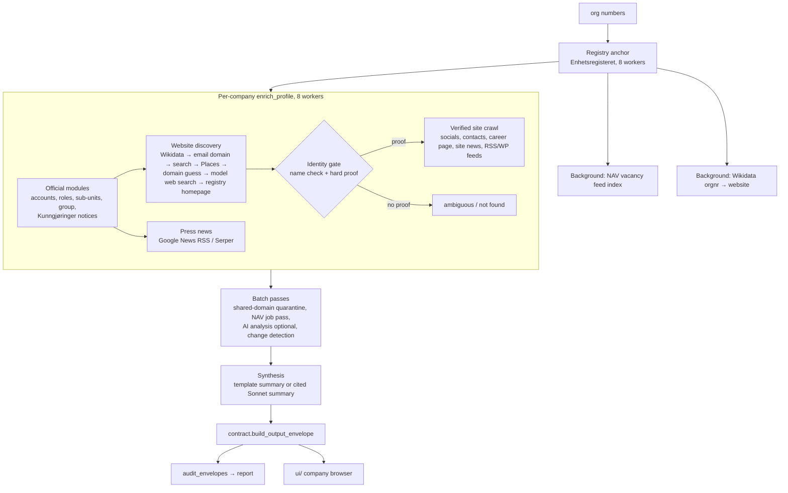

# Signalpost: architecture and scoring plan

State at commit `cdd86d6` (16 Nov 2026). This file covers how the agent is built, and then where the score can still go up. For per-stage detail (costs, every rule, file map), see [`signalpost-architecture-review.md`](signalpost-architecture-review.md). The root `ARCHITECTURE.md` is older and partly out of date: it lists httpx and a "Pydantic data model", but the code uses `urllib` and plain dicts.

---

## 1. What the agent does

Input: a batch of Norwegian organisation numbers (1,000 in the official run, possibly 1,100).
Output: exactly one terminal envelope per number. Each envelope holds claims, evidence (URL, retrieval time, SHA-256, quoted span) and availability states. The run also writes profiles, observations, a report and an HTML company browser.

The whole design rests on one rule: **the org number is the root of trust**. Registry data is published directly. Anything from the open web is treated as a *candidate* until it passes a deterministic proof that ties it to this org number.

## 2. Layers

### 2.1 Orchestration (`run_agent.py`)
- `main()` reads inputs, fetches registry anchors, starts background jobs, runs `enrich_profile` on a thread pool, checkpoints every N companies, runs batch passes, and writes outputs.
- **Run clock** (`web_discovery.CLOCK`): after the soft deadline (34 min) optional discovery stops; after the hard deadline (41 min) model analysis stops. Envelopes are always written. Companies most likely to have a web presence go first.
- **CostGovernor** sets a $9.50 global cap, and `BudgetSlices` set per-task caps. Each call reserves its estimated cost, is then settled at the real cost, and is refunded if it fails. With no keys the cost is $0.

### 2.2 Official layer (`official.py`, `announcements.py`)
Data from Brønnøysund: entity, accounts (sorted newest first, company accounts preferred over group accounts), roles, sub-units, group, and accounting obligation. Kunngjøringer adds dated statutory notices. This layer cannot publish a wrong company, and it supplies most of the 30 precision points.

### 2.3 Discovery layer (`discovery.py`, `web_discovery.py`)
These steps only *propose* URLs. The free sources are Wikidata, the registry email domain, domain guessing (name and alias slugs, DNS checked in parallel) and the registry homepage. The paid sources are Serper/Brave/Google search, a Haiku rerank, Google Places, and Haiku with web search. `web_presence_priority` keeps paid spend away from housing co-ops and dormant holding companies.

### 2.4 Identity layer (`identity.py`, `site_proof.py`, `run_agent._require_hard_site_proof`)
Every candidate goes through these checks in order:
1. **Legal-name check** (`assess_website_identity`): rejects parked pages, accepts the org number in the page, accepts all name tokens appearing together, and accepts a single-token name only with substantive content.
2. **Conflict check** (`verify_candidate_identity`): if the page shows another org number and not ours, the candidate is quarantined.
3. **Hard proof** for every source except the registry and Wikidata: the org number, a sub-unit number, or the registered street address and postcode next to the full legal name. Proof is looked for in the captured pages, then on fresh contact, about and terms pages, then (optionally) in rendered JS, and as a last resort by name-equals-domain plus location.
4. **Batch check** (`quarantine_shared_domains`): one domain belongs to one company unless another company's own org number is on the site.
5. **Socials** must be linked from the verified site (or declared on an org-number-matched NAV ad), and the handle must start or end with the distinctive name.

### 2.5 Activity layer (`nav_jobs.py`, `website.py`, `site_feeds.py`, `news.py`)
- **Jobs:** the NAV `pam-stilling-feed` index (45-day window). An ad matches only when `employer.orgnr` equals the org number or one of its sub-units. Site job posts count if they are under 120 days old. Career-page extraction runs only with the Anthropic key.
- **News:** CMS cards, JSON-LD, WordPress REST and RSS on the verified site, plus press headlines that contain the legal name.

### 2.6 Synthesis (`synthesis.py`, `ai_enrich.py`)
- The template summary opens with one decision fact and its source, then leadership, activity and unknowns.
- The optional Sonnet analysis runs over a numbered fact sheet. Any sentence with no citation, or with a number that is not in the facts it cites, is dropped.

### 2.7 Contract, audit and display (`contract.py`, `run_agent.audit_envelopes`, `ui/`)
- The envelope builder turns evidence records into claims.
- The audit checks one envelope per input, evidence on every claim, wrong-company guards, and the budgets.
- `ui/` builds the company browser, with search, compare, per-source evidence and a phone layout.

---

## 3. How the score is computed (official v2) and where we stand

| Dimension | Points | How it's measured | Our position |
|---|---|---|---|
| Recall and coverage | 50 | For each external family: **70% share of companies** covered + **30% share of facts** found, against the union of everything every entrant and Builderr found | Weak. Smoke run: 21/100 verified websites, 7 companies with news, **0 with jobs**, 7 with socials |
| Precision and evidence | 30 | Exact company, valid evidence and dates | Last official run: 50/56 (89%). Since then the gates have been tightened a lot |
| Synthesis | 12 | Decision-useful, no unsupported claims | Template for about 85% of companies; the AI path has never run live |
| UX | 8 | Find, compare, verify on desktop and mobile | Probably fine after the `ui/` rework |

Last official result was about 53. Reaching 65 means gaining 12 or more points, and most of the room is in **recall**. Precision only needs to hold at 95% or better, because a wrong-company publication can void the run.

Two parts of the formula should drive our priorities:
- **Breadth beats depth.** 70% of each family's score is company coverage. One correct job or news item at a new company is worth far more than a fifth news item at a company that already has four. Every extra item also gives the reviewer another claim to check.
- **A family at zero costs its whole share.** Jobs is at 0 coverage, so even modest coverage there adds points directly.

---

## 4. How to improve the score, in priority order

### P0: Keep precision at 95% or better (blocks everything else)

1. **Regenerate the smoke artifacts before relying on them.** `out/current-smoke-*` was produced on 14 Nov at 09:52 UTC, which is *before* commits `e2099ab` and `f8bde6a`. That output publishes `fisk.no` for B. J. FISK AS (a fishing magazine) and a duplicate news item from an `/author/` URL. I re-ran those companies at HEAD: fisk.no is now `ambiguous` and the author duplicate is gone. Any audit should use a run made at HEAD.
2. **Treat initials and generic words as non-distinctive.** "B. J. FISK" reduces to the single token `fisk`, and that alone passed the legal-name check ("single distinctive token … SPA site"). Hard proof caught it this time, but for a **registry-declared or Wikidata** site the name check alone is still enough. Proposal: when the core is a single token that is a common noun (fisk, bygg, eiendom, transport, …) or the name is mostly initials, always require hard proof.
3. **Cap news age and count.** At HEAD, GROVASTØYLEN AS still publishes five items from 2015, one of them titled "Tirsdag 27. oktober 2016" but dated 2015-10-25. Items that old add almost nothing to recall (they are unlikely to be in a recency-focused pool) and each one is a claim the reviewer can check. Suggestion: publish news at most 24 months old, at most 3 items per company, and drop an item when the year in its title disagrees with its date.
4. **Label provenance honestly.** Sites that were not declared in the registry can still carry `source_type: registry_linked_company_website` (the default label from `fetch_website`), as SLAKTERIET BREKKE AS did. Set the source type to the discovery origin that actually found the URL.
5. **Measure precision instead of spot-checking.** Label about 200 companies by hand (every external claim right or wrong), store the labels in `tests/fixtures/`, and make `scripts/audit_external_claims.py` fail CI when precision drops below 97%. Today every gate change is judged on a handful of examples.

### P1: Recall breadth (where the points are)

1. **Build a declared org number → website cache over the public universe.** This is the biggest lever. The harness explicitly allows "cached public-universe material" if it is declared. Offline, run domain guessing plus hard proof (and optionally a Common Crawl search for pages containing "org.nr NNNNNNNNN") across the 411,160 public org numbers, and store *candidate URLs only*. At run time, re-fetch and re-prove each candidate, so evidence stays fresh and the gate is unchanged. This removes the dependence on search keys and on the 41-minute clock, and it turns discovery from a few seconds per company into a single lookup.
2. **Find out which keys Builderr will actually set.** Serper, Places and Anthropic paths exist but have never run in a scored run. If Builderr sets no keys, about half of the discovery stack is dead code. Ask Builderr directly, then measure the gain from each key on a 150-company sample: added verified sites, cost, and a hand precision check.
3. **Jobs (currently 0).**
   - Read **JSON-LD `JobPosting`** on career pages and ATS pages without a model. Many ATS pages emit it for Google Jobs, so it is deterministic and needs no key.
   - Extend the NAV window beyond 45 days, or cache the feed index between runs (declared). Ads that are still active but older than 45 days are currently missed.
   - Use `employer.homepage` from *every* prefetched NAV entry as a website candidate, not only from companies with active ads.
4. **News breadth.**
   - Google News RSS is the only press source without keys, and it throttles. Spread the requests across the run, put a declared cache in front of it, and give it a budget per company.
   - Find out whether Kunngjøringer notices count toward the news family in the pool. If they do, they are free, exact coverage for almost every company.
5. **Socials.** These come only from verified sites, so they scale with item 1. Also read `sameAs` in JSON-LD Organization blocks on the verified site, which some sites use instead of footer links.
6. **Places/reviews**, if it is a scored family, runs only with a Places key. Confirm that the key is set and that the address-match rule is not too strict.

### P2: Do not lose the run

- **A timeout scores zero.** Runtime is about 33 minutes for 1,000 companies (measured from India), and the official limit is unknown. Ask Builderr for the limit, then set `SIGNALPOST_SOFT_DEADLINE_MIN` and `SIGNALPOST_HARD_DEADLINE_MIN` with a safety margin. Today the defaults of 34 and 41 minutes assume a 45-minute limit. The NAV feed build alone is a floor of about 5 minutes, and the cache in P1.3 removes it.
- Run the full 1,000-company batch at HEAD once before the next freeze, and keep `report.json` as the artifact.

### P3: Synthesis (12 points)

- About 85% of companies get only the template summary. Without inventing anything, it can still add:
  - **peer context from the declared universe snapshot**, for example "11 employees: top 20% of 43.210 electrical installers in the universe", with the snapshot hash as evidence;
  - **a change line** from `refresh.diff_profile` ("new CEO since last run", "2025 accounts filed").
- Run the Sonnet path live on 50 companies before asking Builderr for a key. Record how often sentences are dropped and check the tone.

### P4: Local measurement that matches the official formula

`scripts/score_competition_v3.py` scores an older rubric (sentiment, buzz, workforce). Replace it with a proxy that follows v2: for each family, 70% company recall plus 30% fact recall against a **local union** (everything any of our runs has ever verified, plus the hand labels from P0.5), with precision reported separately. Without this, it is impossible to tell whether a change gained or lost points.

---

## 5. Suggested order of work

1. Regenerate the smoke run at HEAD, add the news caps and the generic-token rule, and fix the provenance label (P0.1–P0.4).
2. Label the gold set and add the precision check to CI (P0.5 and P4).
3. Add the JSON-LD `JobPosting` extractor and extend the NAV window (P1.3).
4. Build the website cache offline and declare it (P1.1).
5. Ask Builderr about keys and the time limit, then measure each key (P1.2, P2).
6. Add the synthesis improvements (P3).
