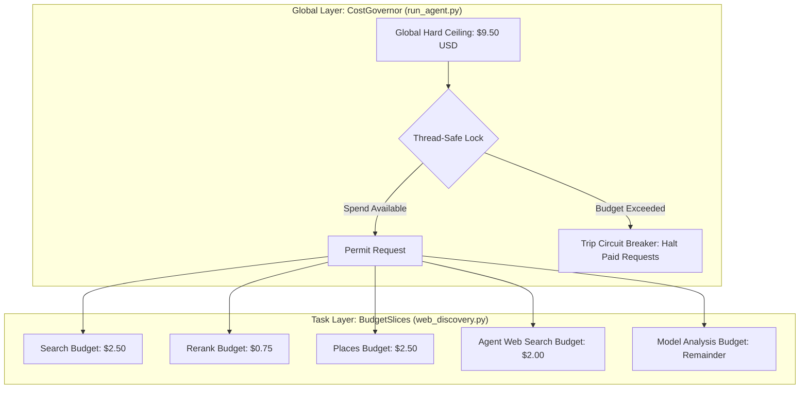

# Cost, Performance & Resource Governance

This document describes how Signalpost enforces budget limits, operational bounds, execution clocks, and hermetic offline testing.

---

## 1. Cost Governance Architecture

In the Builderr Signalpost challenge, runs are bounded by a strict third-party API spend ceiling of **$10.00 USD per 1,000-company batch**. Exceeding this budget incurs immediate disqualification.

Signalpost implements a two-tier governance model:



### 1.1 The Thread-Safe `CostGovernor`
- Maintains a thread-safe atomic counter for accumulated spend across all concurrent worker threads.
- Enforces an active circuit breaker at **$9.50 USD** (providing a $0.50 buffer below the challenge limit).
- Any worker attempting a paid call when the ceiling is breached is immediately blocked, forcing graceful fallback to zero-cost statutory discovery.

### 1.2 Fine-Grained `BudgetSlices`
`web_discovery.py` enforces per-task budget slices configured via environment variables:

| Slice | Environment Variable | Default Limit | Purpose |
| :--- | :--- | :--- | :--- |
| **Search** | `SIGNALPOST_BUDGET_SEARCH` | $2.50 | Serper / Brave / Google Custom Search queries. |
| **Rerank** | `SIGNALPOST_BUDGET_RERANK` | $0.75 | Claude Haiku search snippet reranking. |
| **Places** | `SIGNALPOST_BUDGET_PLACES` | $2.50 | Google Places text search for physical venues. |
| **Agent Search** | `SIGNALPOST_BUDGET_AGENT_SEARCH` | $2.00 | Haiku web search tool for high-priority missing sites. |
| **Careers** | `SIGNALPOST_BUDGET_CAREERS` | $0.50 | Career page candidate scraping. |
| **News** | `SIGNALPOST_BUDGET_NEWS` | $0.75 | External press news discovery. |
| **Model Analysis** | `SIGNALPOST_BUDGET_ANALYSIS` | $9.50 | Claude Sonnet fact-sheet synthesis (uses remaining budget). |

### 1.3 Atomic Spend & Settle Workflow
To avoid under-reporting or over-allocating funds:
1. **Try-Spend (`try_spend`):** The worker atomically checks the slice and reserves the estimated cost before making the network request.
2. **Execute Call:** The outbound request executes.
3. **Settle (`settle`):** Upon response, the worker settles the exact actual cost. If the request failed (e.g. HTTP 429, timeout, network error, or 0 bytes returned), the reservation is refunded ($0.00 billed).
4. **Circuit Breaker:** If consecutive calls to a provider fail, the slice's circuit breaker trips open, skipping subsequent calls for that provider.

---

## 2. Execution Clock & Deadline Governance (`web_discovery.CLOCK`)

Batch evaluations run under a strict 45-minute wall-clock limit. Signalpost uses a monotonically increasing clock with soft and hard deadlines:

```
00:00                     34:00                     41:00              45:00
  │                         │                         │                  │
  ▼                         ▼                         ▼                  ▼
Start Run              Soft Deadline             Hard Deadline      Batch Limit
  │                         │                         │                  │
  ├── Full Enrichment ─────►│                         │                  │
  │   (Search, Crawl,       ├── Official Registry ───►│                  │
  │    Places, News)        │   Enrichment Only       ├── Fast Envelope ─►
  │                         │   (Skip Discovery)      │   Assembly, Disk
  │                         │                         │   Flushes & Report
```

1. **Soft Deadline (`SIGNALPOST_SOFT_DEADLINE_MIN`, default 34 min):**
   - Halts all optional candidate discovery (external web searches, domain guessing, deep network proofing, site feeds, career pages, press news).
   - Preserves all remaining runtime for gathering official registry data for pending companies.
2. **Hard Deadline (`SIGNALPOST_HARD_DEADLINE_MIN`, default 41 min):**
   - Terminates all AI model analysis tasks and background waits.
   - Enforces immediate transition to envelope serialization, report generation, and showcase writing.
   - Guarantees that deliverables are written to disk cleanly without risk of SIGKILL from evaluator runners.

---

## 3. Request Budgets & Network Politeness

- **Request Caps:** Batch runs monitor total requests against official limits (2,000 requests for 100 companies, 20,000 for 1,000 companies).
- **Timeouts:** Strict socket timeouts (2.0s to 10.0s) prevent hung connections on unresponsive target servers.
- **Polite Crawling:** Respects standard robots.txt exclusion rules, adheres to HTTP 429 `Retry-After` headers, and limits concurrent requests per domain to 1.
- **Connection Pooling:** Uses reusable connection pools via standard library `urllib` and `http.client` adapters to minimize socket exhaustion.

---

## 4. Hermetic Offline Testing (`make test`)

Signalpost includes a hermetic, zero-network test suite with **642 automated unit and integration tests**:

```bash
make test
```

### Isolation Guarantees:
1. **Zero Outbound Traffic:** Enforces `HTTP_PROXY=http://127.0.0.1:9`, `HTTPS_PROXY=http://127.0.0.1:9`, and `ALL_PROXY=http://127.0.0.1:9`. Any unauthorized outbound network attempt immediately fails.
2. **Offline Mode:** Runs via `uv run --offline --no-env-file --locked`.
3. **Deterministic Mock Fixtures:** All external registries, search engines, and web pages are mocked using frozen JSON/HTML fixtures in `tests/fixtures/`.
4. **Speed:** All 642 tests execute in under 15 seconds.
