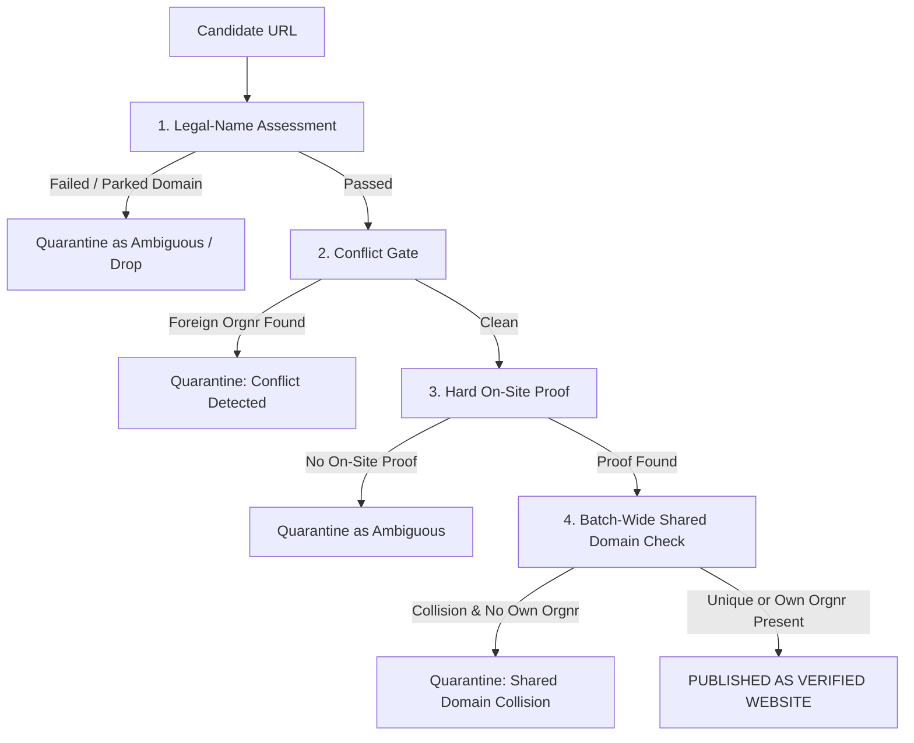

# Identity Resolution & Anti-Contamination Gates

This document details Signalpost's anti-hallucination and anti-contamination architecture. In corporate intelligence, attributing data from Company A to Company B (e.g., sister companies, franchises, shared holding domains, or namesakes) is catastrophic. Signalpost enforces a multi-tiered gatekeeper system anchored in official Norwegian registries.

---

## 1. The Root-of-Trust Philosophy

```
Official Registry (data.brreg.no)
         │
         ▼
[9-Digit Organisation Number] ───► Immutable Root of Trust
         │
         ├── Primary Orgnr
         ├── Sub-unit Numbers (underenheter)
         ├── Registered Physical Address & Postal Code
         └── Legal Name & Distinctive Tokens
```

1. **Registry Data is Pre-Verified:** Data originating directly from Brønnøysundregistrene (Enhetsregisteret, Regnskapsregisteret, Roller) is anchored by definition and emitted directly.
2. **Open Web Data is Merely a Candidate:** Every URL, social profile, news article, or job posting discovered through search engines, email domains, Wikidata, or algorithmic guessing is treated as an unverified candidate. It cannot enter the final profile envelope without passing deterministic identity proofs.
3. **No Model-Decided Identity:** Large Language Models are strictly prohibited from making identity decisions or guessing whether a website belongs to a company. Identity is verified purely through deterministic regex, token parsing, and statutory matching.

---

## 2. Multi-Number Company Identity Profile

To distinguish between corporate structures, parent groups, and branches, `identity.py` constructs a `CompanyNumberProfile`:

```python
CompanyNumberProfile = {
    "primary_orgnr": "923609016",
    "subunit_orgs": ["973123456", "981654321"], # Physical branch workplaces
    "group_orgs": ["912345678"],                 # Parent / group relationships
    "legal_name": "EQUINOR ASA",
    "distinctive_tokens": ["EQUINOR"],
    "registered_address": "FORUSBEEN 50",
    "postal_code": "4035",
    "municipality": "STAVANGER"
}
```

This multi-number profile enables **dual-action verification**:
- **Positive Corroboration:** Evidence displaying either the primary organisation number or any registered sub-unit number is accepted.
- **Negative Rejection (Conflict Gate):** Evidence displaying a 9-digit Norwegian organisation number that matches *none* of the company's numbers is immediately flagged as a conflict.

---

## 3. Four-Tiered Website Identity Gating

Every candidate website URL must pass through four sequential verification stages before being published:



### Tier 1: Legal-Name Assessment (`assess_website_identity`)
- Scans candidate page text (homepage title, H1, meta descriptions, identity text).
- Rejects parked domains, domain brokers ("this domain is for sale"), and CMS default placeholders.
- Matches name tokens against the company's official legal name.
- Prevents false matches on common generic words (e.g., "NORDIC", "KONSULT", "GRUPPEN") by requiring all distinctive tokens or exact phrase matches.

### Tier 2: Conflict Gate (`verify_candidate_identity`)
- Scans candidate text using Norwegian 9-digit organisation number regexes (`\b[89]\d{8}\b`).
- Validates each discovered number using the Modulo-11 checksum algorithm.
- **Rule of Non-Contamination:** If the candidate page contains one or more 9-digit numbers, and *not a single one* belongs to the target company (or its registered sub-units/group), the candidate is flagged with `conflict: True` and immediately rejected.
- **Impact:** Completely eliminates false attributions when two distinct companies share identical or similar trade names in different municipalities.

### Tier 3: Hard On-Site Proof (`site_proof.py` & `_require_hard_site_proof`)
For all websites not discovered directly in the official statutory registry, hard proof is required:
1. **Primary Orgnr or Sub-unit Orgnr:** Must appear verbatim on the site.
2. **Statutory Address Proof:** The registered street address and postal code must appear together with the company's legal name as a contiguous phrase.
3. **Deep Page Crawl:** If the homepage lacks proof, the verification engine crawls statutory subpages: `/kontakt`, `/kontakt-oss`, `/om-oss`, `/about`, `/personvern`, `/kjopsbetingelser`, `/vilkar`.
4. **JavaScript Fallback:** For Single-Page Applications (SPAs), an optional headless browser render checks the dynamically generated footer.
5. **Name-Domain-Location Proof:** For domains matching the distinctive name tokens where the location is confirmed on-site, rigorous token constraints apply.

### Tier 4: Batch-Wide Shared Domain Quarantine (`quarantine_shared_domains`)
- At the end of batch enrichment, Signalpost audits all verified domains across the entire batch of organisations.
- If multiple companies in the batch claim the same domain (e.g., a shared corporate group site, accounting agency portal, or property management site):
  - Only the company whose *own* 9-digit organisation number appears on that site is permitted to retain it.
  - All other companies have the website revoked and set to `availability: "ambiguous"`, preventing parent company attributes from polluting subsidiaries.

---

## 4. Claim Publication Rules & Gates

Signalpost enforces strict rules across all claim categories:

| Claim Family | Publication Criteria |
| :--- | :--- |
| **Official Website** | Either declared in official registry with legal name on homepage, or passes all 4 tiers of the Website Identity Gate. Uncorroborated domains emit `ambiguous`. |
| **Social Profiles** | Must be hyperlinked from the verified company website (or declared on an orgnr-matched NAV ad), AND the handle must start or end with the distinctive legal name. Site-builder handles (`twitter.com/squarespace`, `facebook.com/wix`) and housing manager handles are blocked. |
| **Job Postings** | 1. Official NAV Arbeidsplassen vacancy feed: `employer.orgnr` matches the company orgnr or a registered sub-unit.<br>2. On-site career postings: verified website with publication date within the last 120 days. |
| **Company News** | Dated article from the verified website (via RSS / WordPress API / JSON-LD / article subpaths). Press headlines from Google News RSS must carry the full legal name (name without "AS" is accepted only for companies with 10+ employees or NOK 20M+ revenue). |
| **Annual Accounts** | Extracted from Regnskapsregisteret. Filings are sorted newest-first. Company accounts (`SELSKAP`) are preferred over group accounts (`KONSERN`) for the same period. |
| **Model Analysis** | Claude Sonnet 5.5 operates strictly from a numbered fact sheet of pre-verified evidence. Every generated sentence must cite fact IDs (`[fact-1]`). Uncited sentences or sentences citing non-existent facts are discarded. |
