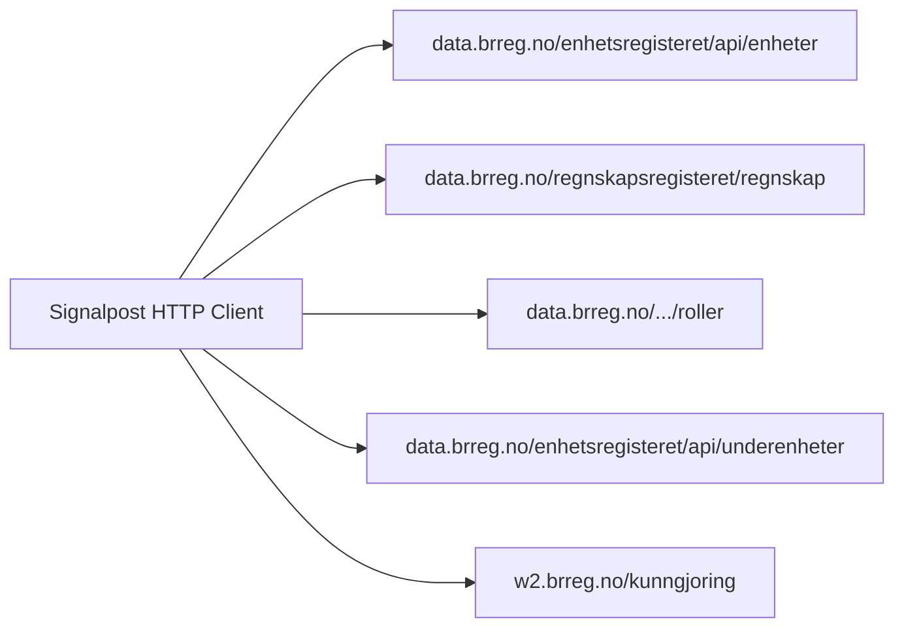
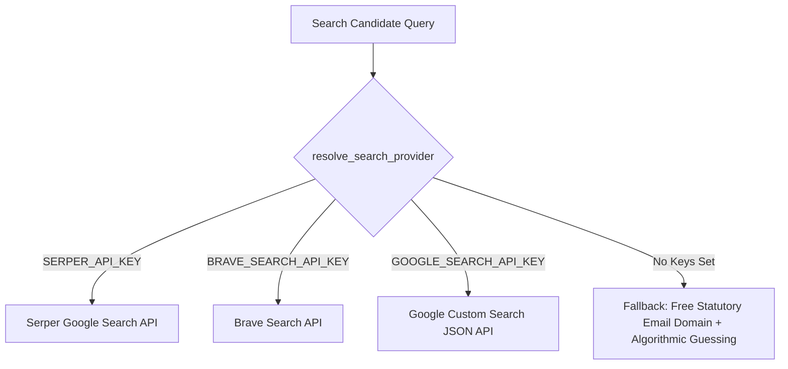

# External Integrations & Connectors

This document describes all data sources, official APIs, public scrapers, search providers, and AI connectors integrated into Signalpost.

---

## 1. Authoritative Norwegian Statutory Registers ($0.00 Cost, No Keys Required)

All baseline operations use official, open Norwegian government endpoints provided by Brønnøysundregistrene.



### 1.1 Enhetsregisteret API (`official.py`)
- **Endpoint:** `https://data.brreg.no/enhetsregisteret/api/enheter/{orgnr}`
- **Provides:** Canonical legal name, organizational form (`organisasjonsform.kode`), registration dates, NACE industry codes (`naeringskode1`), postal address (`postadresse`), physical business address (`forretningsadresse`), statutory employee count (`antallAnsatte`), registered homepage (`hjemmeside`), official email (`epostadresse`), and historical legal names (`historiskeNavn`).
- **Resilience:** Automatic retry with exponential back-off on HTTP 429/503.

### 1.2 Regnskapsregisteret API (`official.py`)
- **Endpoint:** `https://data.brreg.no/regnskapsregisteret/regnskap/{orgnr}`
- **Provides:** Audited statutory annual accounts:
  - Revenue: `inntekter.salgsinntekter` or `sumDriftsinntekter`
  - Operating Result: `driftsresultat.driftsresultat`
  - Net Profit / Loss: `aarsresultat`
  - Balance Sheet: `eiendeler.sumEiendeler`, `egenkapitalGjeld.sumEgenkapitalGjeld`, `sumEgenkapital`, `sumGjeld`
  - Accounting Period: `regnskapsperiode.fraDato` to `regnskapsperiode.tilDato`
  - Currency: NOK
- **Filing Selection Policy:** Sorted newest-first. Company accounts (`SELSKAP`) are preferred over group consolidated accounts (`KONSERN`) for the same period.

### 1.3 Roles & Signatories API (`official.py`)
- **Endpoint:** `https://data.brreg.no/enhetsregisteret/api/enheter/{orgnr}/roller`
- **Provides:** Active leadership roles: CEO / Managing Director (`DAGL`), Board Chairperson (`LEDE`), Board Members (`MEDL`), Deputy Members (`VARA`), and registered Auditor (`REVI`).

### 1.4 Sub-units & Workplaces API (`official.py`)
- **Endpoint:** `https://data.brreg.no/enhetsregisteret/api/underenheter?overordnetEnhet={orgnr}`
- **Provides:** All physical branch workplaces (*underenheter*) belonging to the parent enterprise, each with its own 9-digit organisation number, address, and municipality. Used to populate the `CompanyNumberProfile` for workplace mapping and conflict checking.

### 1.5 Kunngjøringer Statutory Notices (`announcements.py`)
- **Endpoint:** `https://w2.brreg.no/kunngjoring/hent_en.jsp?orgnr={orgnr}`
- **Provides:** Public legal notices published by Brønnøysund:
  - Bankruptcy petitions, openings, and closures
  - Dissolution and liquidation notices
  - Capital increases and reductions
  - Board and management changes
  - Mergers and demergers

---

## 2. NAV Arbeidsplassen Vacancy Feed ($0.00 Cost, Public Token)

The Norwegian Labour and Welfare Administration (NAV) provides an open vacancy feed (`nav_jobs.py`):

```
Token URL: https://pam-stilling-feed.nav.no/api/publicToken
Feed URL:  https://pam-stilling-feed.nav.no/api/v1/feed
Entry URL: https://pam-stilling-feed.nav.no/api/v1/feedentry/{uuid}
```

- **Authentication:** Fetches NAV's openly published bearer token dynamically at runtime (`/api/publicToken`). No private key required.
- **Background Ingestion:** A background thread builds the index at batch start. With the declared cache (`data/cache/nav-jobs.jsonl.gz`, sha256-checked against `data/cache/manifest.json`, no older than `NAV_FEED_DAYS` = 45) it walks only the feed pages after the cache cursor; otherwise it walks the last 45 days (bounded by `NAV_FEED_MAX_SECONDS=720`).
- **Cached ads are candidates only:** each one is re-fetched live and published only if it is still `ACTIVE` with a matching `employer.orgnr`.
- **Verification Rule:** Ads are matched strictly by `employer.orgnr` matching the parent company orgnr or any registered sub-unit orgnr.
- **Failover:** If the feed is unreachable, the connector gracefully fails over to the public search endpoint (`https://arbeidsplassen.nav.no/stillinger`) with strict rate limiting.

---

## 3. Wikidata SPARQL Knowledge Base ($0.00 Cost, CC0)

Signalpost queries the Wikidata SPARQL endpoint (`web_discovery.py`):

- **Endpoint:** `https://query.wikidata.org/sparql`
- **Batching:** Queries up to 150 organisation numbers in a single SPARQL query.
- **Query Logic:** Matches property `P2333` (Norwegian organisation number) to `P856` (official website).
- **Ranking:** Sites ranked `.no` first, then `.com`, then shortest URL.
- **Gate:** Candidates must still pass the legal-name check or hard on-site proof.

---

## 4. Multi-Provider Web Search Discovery (Optional)

Signalpost features a unified, multi-provider web search abstraction (`discovery.py`):



- **Interchangeable Design:** Evaluators only need to provide **any one** of the 3 search keys (or none).
- **Auto-Detection:** Automatically detects the available key, or respects `WEB_SEARCH_PROVIDER=auto|serper|brave|google`.
- **Query Strategy:**
  1. Primary Query: `{legal_name} {municipality}` (e.g. `EQUINOR ASA STAVANGER`).
  2. Follow-up Query: `"{legal_name}" {orgnr}` if no candidates found in the first round.
- **Hard Anti-Contamination Rule:** Search result URLs and snippets are candidates only, never claim evidence. Candidates must be fetched and verified on-site.

---

## 5. Optional Platform Connectors

### 5.1 Google Places Text Search (`official_external.py`)
- **Key:** `GOOGLE_PLACES_API_KEY`
- **Usage:** Queries Places Text Search for company name and municipality.
- **Verification:** The place's website is only accepted if the place address matches the registered statutory street address and postal code. Responses are cached so place-summary observations reuse the exact same request.

### 5.2 YouTube Data API (`official_external.py`)
- **Key:** `YOUTUBE_DATA_API_KEY`
- **Usage:** Queries channel metadata when a verified company website links to a YouTube channel.
- **Verification:** The channel handle or title must match the company's distinctive legal name.

---

## 6. Anthropic Claude AI Enrichment (`ai_enrich.py`)

Signalpost uses Anthropic Claude (Sonnet 5.5 and Haiku 5.5) as an optional, cost-governed synthesis and analysis accelerator:

- **Haiku 5.5 Reranker (`SIGNALPOST_SEARCH_MODEL`):** Reads search snippets to rank the top 3 most promising official candidate URLs and identify brand aliases. Operates under strict bounds: can only select URLs returned by the search provider and brand names present verbatim in snippets.
- **Sonnet 5.5 Synthesis (`SIGNALPOST_AI_MODEL`):**
  - Synthesizes executive summaries for high-confidence companies with verified websites, open job postings, or news.
  - **Fact-Sheet Constraint:** Receives a numbered fact sheet of pre-verified evidence items. Every sentence output by the model must cite the corresponding fact ID (e.g. `[fact-1]`).
  - **Hallucination Pruning:** A post-processor parses all citations; any sentence lacking a citation, citing a non-existent fact, or stating numbers absent from cited facts is immediately deleted.
