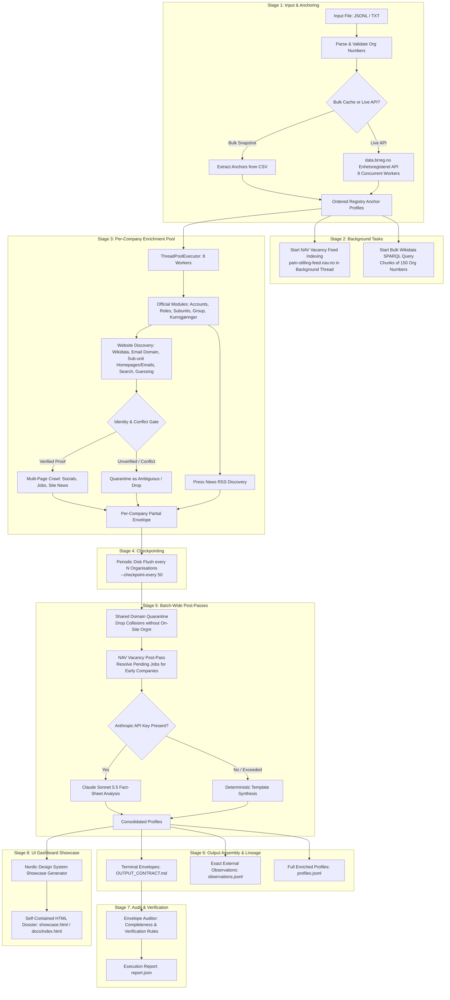

# System Overview & Orchestration

This document describes the end-to-end orchestration, pipeline lifecycle, worker concurrency, and timing budgets of the Signalpost system.

---

## 1. High-Level Architecture Lifecycle

Signalpost executes a staged, asynchronous pipeline orchestrated by `run_agent.py`. The execution flows through 8 sequential stages, maximizing throughput via thread pooling while protecting precision through deterministic identity barriers.

---

## 2. Stage Breakdown & Execution Details

### Stage 1: Input Validation and Registry Anchoring
- **Input Formats:** Accepts `.json`, `.jsonl`, or single-column `.txt` files containing 9-digit Norwegian organisation numbers.
- **Anchor Source:**
  - When `--bulk` is provided: Reads from a frozen snapshot of the Brønnøysund register CSV.
  - When live (default): Queries `https://data.brreg.no/enhetsregisteret/api/enheter/{orgnr}` across 8 parallel workers.
- **Anchor Artifact:** Establishes legal name, business form (`AS`, `ENK`, `DA`, `ASA`), NACE industry codes, registration date, statutory addresses, registered website (`hjemmeside`), and official email (`epostadresse`).

### Stage 2: Background Task Initialization
Before individual company worker threads start, two global background tasks launch to minimize latency:
1. **NAV Arbeidsplassen Vacancy Feed Indexer (`nav_jobs.py`):**
   - Connects to `https://pam-stilling-feed.nav.no/api/v1/feed` using NAV's public bearer token (`/api/publicToken`).
   - Loads the declared cache of active ads (`data/cache/`) and walks only the feed changes since its cursor; without a usable cache it walks the last 45 days (`NAV_FEED_DAYS`).
   - Prefetches ads for companies in the input batch into memory, organized by employer organisation number.
2. **Wikidata SPARQL Website Resolver (`web_discovery.py`):**
   - Dispatches batched SPARQL queries (up to 150 organisation numbers per query) to query Wikidata property `P2333` (Norwegian organisation number) -> `P856` (official website).
   - Injects confirmed website candidates into candidate profiles with zero API cost.

### Stage 3: Per-Company Enrichment Pool
Companies are prioritized by web-presence likelihood (`web_discovery.web_presence_priority`), ensuring that active commercial enterprises are processed first while dormant entities or housing co-operatives are handled toward the end:
- **Official Sub-Modules:**
  - `financials`: Queries `data.brreg.no/regnskapsregisteret/regnskap/{orgnr}`. Filings are sorted newest-first; company accounts (`SELSKAP`) are prioritized over group accounts (`KONSERN`) for identical financial periods.
  - `roles`: Queries `data.brreg.no/enhetsregisteret/api/enheter/{orgnr}/roller` to map CEO (`DAGL`), board chair (`LEDE`), board members, and auditors.
  - `locations`: Queries `/underenheter?overordnetEnhet={orgnr}` to discover all registered sub-units and physical workplaces.
    Sub-unit homepages and email domains (`subunit_contacts`) are kept as website candidates for discovery step A2; they need the same hard proof as any other candidate and are never published directly. Locations are sorted by org number so refresh runs report no false changes.
  - `announcements`: Scrapes `w2.brreg.no/kunngjoring` notices for bankruptcy filings, capital changes, auditor appointments, and merger announcements.
- **Website Discovery & Anti-Contamination Gate:**
  - Evaluates candidates in priority order: Wikidata -> statutory email domain -> search discovery (Serper / Brave / Google Search) -> Google Places -> algorithmic `.no`/`.com` domain guessing.
  - Every candidate domain must pass through the `assess_website_identity` legal-name check, the `verify_candidate_identity` conflict gate, and `_require_hard_site_proof`.
- **Verified Site Crawling:**
  - If verified, the site is crawled up to bounded depth (/kontakt, /om-oss, /karriere, /nyheter, /personvern).
  - Extracts social media links, structured `JobPosting` JSON-LD schemas, and same-domain RSS / WordPress news feeds.

### Stage 4: Mid-Run Checkpointing & Resilience
- Every $N$ companies (`--checkpoint-every 50`), the orchestrator flushes intermediate envelopes and profiles to disk.
- Flagged partial envelopes (`_checkpoint_partial: True`) allow long batch runs (e.g., 1,000+ companies) to resume interrupted runs via `--resume` without losing work.

### Stage 5: Batch-Wide Post-Passes
After the per-company worker pool terminates, three crucial batch-wide operations execute:
1. **Shared-Domain Quarantine (`quarantine_shared_domains`):**
   - Detects scenarios where multiple unrelated companies in a batch share a single domain (e.g., holding companies, shared accounting portals, franchise platforms).
   - Only companies whose exact 9-digit orgnr appears on the domain are permitted to retain it; all other companies have the website quarantined as `ambiguous`.
2. **NAV Vacancy Matching Post-Pass:**
   - Any company that completed Stage 3 before the background NAV feed index finished building is re-evaluated against the completed index.
3. **Optional Model Analysis (`ai_enrich.py`):**
   - If an Anthropic API key is provided and the budget permits, eligible companies (those with verified websites, job postings, or news) are processed by Claude Sonnet 5.5.
   - Claude works strictly from a numbered, pre-verified fact sheet. Sentences without valid fact-ID citations are automatically filtered out.

### Stage 6 & 7: Output Assembly, Audit & Lineage
- Builds contract-compliant envelopes via `contract.build_output_envelope`.
- Emits exact external observations to `observations.jsonl`.
- Compiles execution metrics, p50/p95 request latencies, and third-party API spend into `report.json`.
- Runs `audit_envelopes` to guarantee zero fabricated financials and 100% claim/evidence lineage validity.

### Stage 8: Showcase Generation
- Generates an interactive, standalone HTML dossier (`showcase.html` / `docs/index.html`) using the Nordic Corporate Intelligence design system.
- Includes client-side searching, financial trajectory charts, and one-click cryptographic SHA-256 evidence inspection.

---

## 3. Concurrency Model & Run Clocks

Signalpost uses a multi-threaded execution model designed for I/O-bound web and API crawling:

| Worker Pool | Default Concurrency | Purpose |
| :--- | :--- | :--- |
| **Registry Anchors** | 16 threads (`--workers`) | Rapidly fetches Enhetsregisteret entity anchors. |
| **Enrichment Workers** | 16 threads (`--workers`) | Runs the official submodules, discovery, and site crawling per company. |
| **NAV Feed Prefetch** | 4 threads | Concurrently prefetches active NAV job postings. |
| **AI Analysis Workers** | 6 threads (`SIGNALPOST_AI_WORKERS`) | Processes Sonnet 5.5 fact sheets when enabled. |

### Run Clock Deadlines (`web_discovery.CLOCK`)
To prevent batch execution timeouts during large runs (such as the 45-minute 1,000-company evaluation budget), Signalpost enforces two global deadlines:

1. **Soft Deadline (`SIGNALPOST_SOFT_DEADLINE_MIN`, default 34 min):**
   - Once elapsed, all optional discovery operations (web search, domain guessing, deep network proofing, site feeds, career pages, press news) immediately halt.
   - Workers strictly finish gathering official registry data for pending companies.
2. **Hard Deadline (`SIGNALPOST_HARD_DEADLINE_MIN`, default 41 min):**
   - Once elapsed, AI model analysis immediately terminates, and background task waits abort.
   - The pipeline transitions immediately to envelope synthesis and output disk writes, ensuring complete deliverables are always written before the evaluation window closes.
